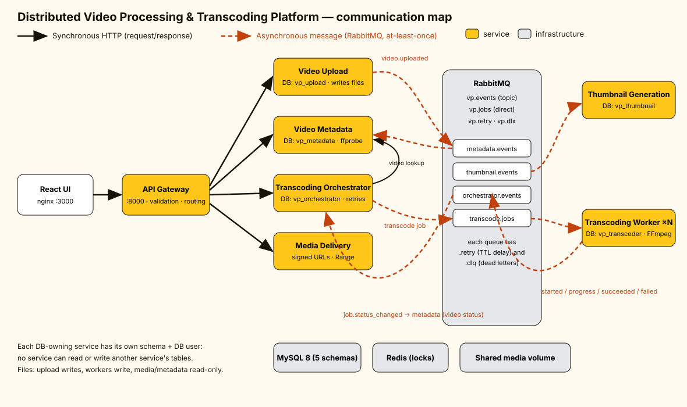
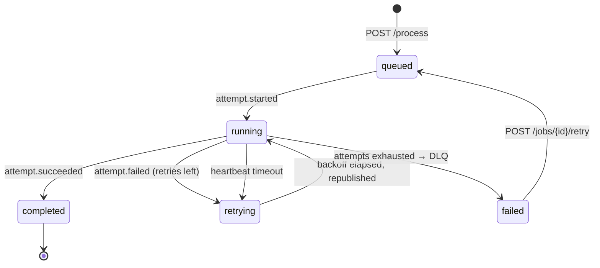
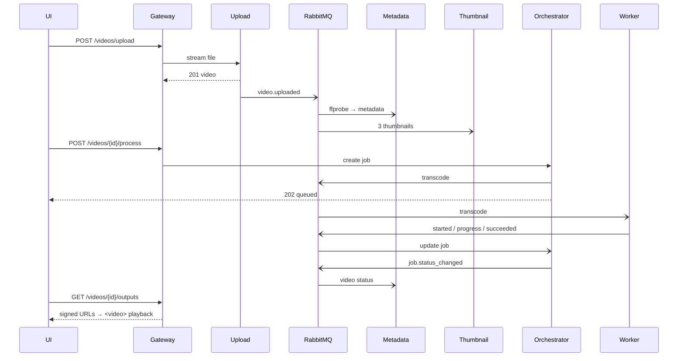

# Architecture

## Services

| Service | Port (host) | Owns | Responsibilities |
|---|---|---|---|
| **API Gateway** | 8000 | – | Single public entry point. Request validation, routing, streaming proxy for uploads/media, CORS, `X-Request-ID`, 502/504 mapping, `/health/services`. |
| **Video Upload** | 8001* | `vp_upload.videos` | Validates (extension, MIME, magic bytes, size, title), streams the file to storage with a SHA-256 checksum, records the video, publishes `video.uploaded` (transactional-outbox flag + republisher). |
| **Video Metadata** | 8002* | `vp_metadata.video_metadata` | Consumes `video.uploaded` → `ffprobe` → stores codec/size/duration. Consumes `job.status_changed` → keeps the user-facing status/progress. Serves `GET /videos*`. |
| **Transcoding Orchestrator** | 8003* | `vp_orchestrator.processing_jobs` | Creates jobs (`POST /videos/{id}/process`), publishes work, owns retry policy (exponential backoff stored in DB), dead-lettering, stale-worker reaper, manual retry. |
| **Transcoding Worker** | 8004* | `vp_transcoder.processing_attempts`, `transcoding_outputs` | Consumes `transcode.jobs`, runs FFmpeg per resolution, emits started/progress/succeeded/failed. Horizontally scalable (`--scale transcoder=N`). |
| **Thumbnail Generation** | 8005* | `vp_thumbnail.video_thumbnails` | Consumes `video.uploaded`, extracts 3 JPEGs (25/50/75 %), retries in-process. |
| **Media Delivery** | 8006* | – | Lists renditions/thumbnails and serves them through HMAC-signed, expiring URLs with HTTP Range support and path-traversal protection. |

\* only exposed on the host by `scripts/dev_stack.sh`; in Docker Compose only the gateway (8000), UI (3000) and RabbitMQ console (15672) are published.

## Synchronous vs asynchronous communication

**Synchronous (HTTP)** – only where the caller needs the answer to respond to a user:
- Browser → Gateway → {Upload, Metadata, Orchestrator, Media} for every public API call.
- Orchestrator → Metadata (is this video known and analysed?) when a job is requested.
- Media → Transcoder / Thumbnail internal read APIs to list files.

**Asynchronous (RabbitMQ)** – everything slow or that must survive failures:

| Message | Publisher → Consumer | Purpose |
|---|---|---|
| `video.uploaded` | Upload → Metadata, Thumbnail | analyse the file, generate thumbnails |
| `transcode` | Orchestrator → Worker (`transcode.jobs`) | do the heavy work |
| `job.attempt.started / progress / succeeded / failed` | Worker → Orchestrator | report state |
| `job.status_changed` | Orchestrator → Metadata | update video status shown in the UI |

`POST /videos/{id}/process` only inserts a job row and publishes a message, then returns **202** – the API is never blocked by FFmpeg.

## Data ownership

One MySQL schema **and** one MySQL user per service (`infra/mysql/init.sh`); credentials are not shared, so a service physically cannot touch another's tables. Cross-service data goes through HTTP APIs or events, never joins. Schemas are versioned with per-service Alembic migrations (`services/*/migrations`), applied automatically at container start.

| Table | Service |
|---|---|
| `videos` | upload |
| `video_metadata` | metadata |
| `processing_jobs` | orchestrator |
| `processing_attempts`, `transcoding_outputs` | transcoder |
| `video_thumbnails` | thumbnail |

## Reliability design

- **Retry limits.** Each job has `max_attempts` (default 3). A failed attempt is recorded (`processing_attempts.error_*`) and the orchestrator schedules the next one with exponential backoff (`next_retry_at`, 5 s → 10 s → … capped 120 s). The scheduler tick republishes due retries, so retries survive restarts.
- **Dead-letter queue.** Exhausted/permanent failures are published to `vp.dlx` → `transcode.jobs.dlq`; the job is marked `failed` + `dead_lettered`. A poisoned message that keeps throwing in a consumer goes through `<queue>.retry` (TTL delay queue) up to `consumer_max_redeliveries`, then `<queue>.dlq`.
- **Manual retry.** `POST /jobs/{id}/retry` grants a fresh attempt budget for a failed job.
- **Duplicate handling.** RabbitMQ is at-least-once, so consumers are idempotent: Redis lock `SET NX EX` per job/attempt + `UNIQUE(job_id, attempt_number)` in MySQL; an already-finished attempt re-emits its result instead of re-encoding; stale events (older attempt number) are ignored; only one active job per video (409).
- **Crash safety.** Workers send heartbeats; the orchestrator's reaper fails attempts with no heartbeat for `job_stale_seconds` and retries. Output files are written to temp names and `os.replace`d. Upload uses an outbox flag so a broker outage after the DB commit never loses `video.uploaded`.
- **Non-blocking API.** Broker unavailability during `/process` still returns 202 (job persisted; scheduler publishes later).
- **Upload validation.** Extension allow-list, declared content-type vs extension, magic bytes, `Content-Length` pre-check (411/413) *and* streaming size cap, title length, uniform error envelope `{"error":{code,message,details},"request_id"}`.
- **Stored errors.** Every failure keeps type/message per attempt and the latest error on the job and video; the UI shows them.
- **No upscaling.** Requested heights above the source are skipped (a 720p source yields 360p + 720p even if 1080p is requested).

## Job state machine

## Sequence: upload → playback

